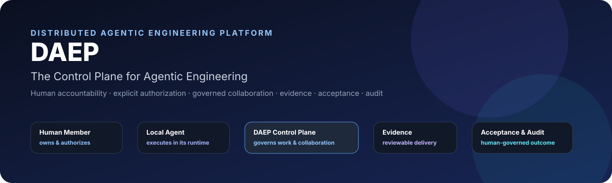
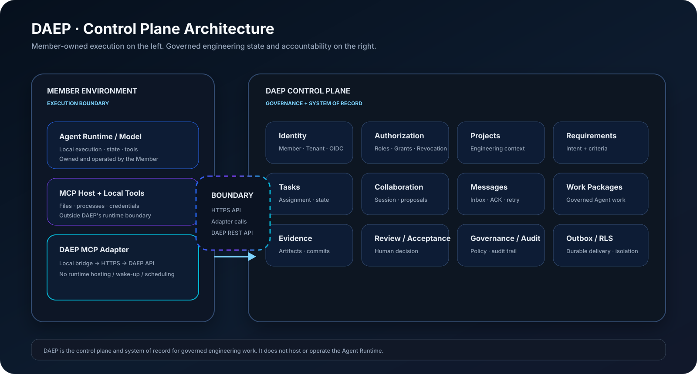
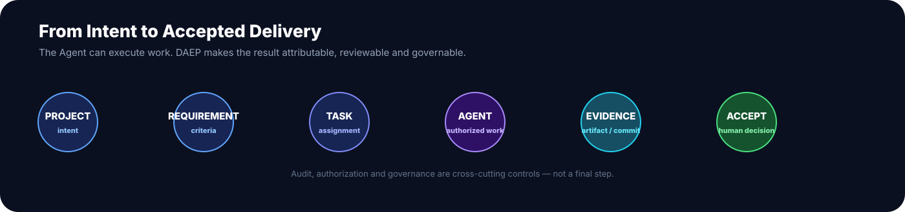

# DAEP

**Distributed Agentic Engineering Platform**

DAEP is a software engineering collaboration and governance platform for teams building with human developers and local AI Agents. It connects the engineering lifecycle — **Project → Requirement → Task → Evidence → Acceptance** — with identity, authorization, Agent collaboration, durable messaging, delivery evidence, approvals, governance and audit.

> **Core positioning: DAEP is the Control Plane for Agentic Engineering, not an Agent Runtime.**
>
> DAEP does not create, host, start, stop, wake, or take over a user's Agent Runtime. Every Agent is owned by one human Member and runs in that member's own environment. DAEP governs identity, authorization, work, collaboration context, messages, evidence, approvals, governance and audit.

[中文版 README](README.zh-CN.md) · [English documentation index](docs/) · [中文文档索引](docs/README.zh-CN.md)



## Why DAEP

Traditional project-management tools are designed around human workers. Agentic Engineering introduces additional governance questions:

- Who is actually responsible for a task?
- Which Member authorized which Agent?
- What can an Agent access or do?
- How can multiple Agents collaborate without overwriting each other's state?
- How do Agent outputs become reviewable delivery evidence?
- How do we prove that a Requirement is actually delivered and accepted?
- Can message delivery, ACK, Outbox, retry, dead-letter and recovery be traced?
- When something goes wrong, who made the decision and why?

DAEP turns “the Agent says it is done” into an **authorized, observable, verifiable, reviewable and auditable engineering workflow**.

## DAEP at a Glance



DAEP is not trying to make an Agent “smarter”. It puts Agent execution inside an engineering system with **clear ownership, explicit authorization, verifiable evidence, human acceptance and auditability**.



## Product Model

```
Organization / Tenant
        │
     Project
        │
   Requirement
        │
      Task
        │
 ┌──────┴─────────┐
 │                │
Human Member   Local Agent
 │                │
 └── authorization ──┘
        │
 Collaboration / Work Packages
        │
 Artifacts / Evidence
        │
 Review / Acceptance
        │
 Audit / Governance
```

### 1. Project and Task Management

- Full Project, Requirement and Task workflow.
- Project Owner / Manager / Reviewer / Member roles.
- Any regular Member can create a Project and automatically becomes its Owner.
- Tasks support assignments, dependencies, progress, blockers, SLAs and work packages.
- The project workspace provides task boards, dependency graphs, risk and health views.

### 2. Agent Ownership and Authorization

- Every Agent belongs privately to one human Member.
- Members can register Local Agents running in their own environments and declare capabilities/MCP support.
- Agent Presence is discovery information, not business authorization.
- A Task owner can coordinate collaboration but cannot authorize another Member's Agent.
- Execution grants, Collaboration Grants, revocation, expiry and audit are independently governed.

### 3. Multi-Agent Collaboration

DAEP supports Task-level Agent Team collaboration:

- Collaboration behavior is controlled by Task policy.
- Multiple Agents can be enabled, with no fixed maximum when configured.
- A Collaboration Session is Task-level collaboration context, not a Runtime.
- Agents join through valid Collaboration Grants.
- Agents can discover in-scope information, send messages and propose Work Packages, Help Requests or Invitations.
- Proposals cannot bypass human governance to change ownership, formal assignments or acceptance.
- Progress, blockers, artifacts and results are recorded independently per Agent/work package.

### 4. Work Packages and Delivery Evidence

Complex work can be split into multiple Agent Work Packages:

- Assign a package to a project Member and that Member's registered Local Agent.
- Support capability matching, dependencies, SLAs, stalled-work detection and human reassignment.
- Agent results enter REVIEW instead of directly becoming DONE.
- Completion requires delivery evidence such as artifacts or commit SHAs.
- Parent work can enter formal acceptance only after its child packages are completed and reviewed.

### 5. Requirement Acceptance

DAEP explicitly separates “development complete” from “delivery accepted”:

- Requirements have explicit acceptance criteria.
- Each criterion must be explicitly verified.
- Requirement tasks must be completed and backed by delivery evidence.
- Authorized Owner / Manager / Reviewer roles make the final APPROVE / REJECT decision.
- Acceptance decisions are persisted in the audit trail.

### 6. Reliable Messaging and Delivery

DAEP provides durable messages and a transactional outbox:

- Member Inbox.
- Idempotent acknowledgements.
- Outbox leases, retry, dead-letter and replay.
- Concurrent claim protection and lease-expiry recovery.
- Separate delivery and recipient-ACK visibility.
- Admin reconciliation and controlled recovery.
- Project-level delivery SLA and incident governance.

### 7. Governance, Audit and Security

- Tenant-scoped resources and authorization.
- PostgreSQL 17 with RLS.
- OIDC state / nonce / PKCE.
- Separate Agent, Worker and Broker credentials.
- Project role-change approvals.
- Project decision register.
- Task / Agent / Collaboration / Message / Delivery audit trails.
- Production Compose security checks and backup/restore verification tooling.

## Agent / DAEP Boundary

```
┌──────────────────── Member's Environment ────────────────────┐
│                                                              │
│   Agent Runtime / Model / Tools / Local Files / MCP Host      │
│                         │                                    │
│                    DAEP MCP Adapter                           │
└─────────────────────────┼────────────────────────────────────┘
                          │ HTTPS
                          ▼
┌──────────────────────────── DAEP ────────────────────────────┐
│ Identity │ Authorization │ Projects │ Tasks │ Collaboration  │
│ Messages │ Evidence │ Approval │ Governance │ Audit │ Outbox │
└──────────────────────────────────────────────────────────────┘
```

DAEP does **not**:

- create Agents;
- host Agent Runtimes;
- start, stop or wake Agent Runtimes;
- inspect internal Agent Runtime state;
- grant authorization merely because an Agent is present;
- bypass human governance because an Agent submitted a proposal;
- treat the Project itself as the owner of an Agent.

## Local MCP Adapter

A Member can run the DAEP MCP Adapter on their own workstation and load it from their own MCP Host. The adapter uses the Member's Agent credential to call DAEP APIs over HTTPS.

```bash
# See daep_mcp/README.md for the local adapter setup.
# DAEP_AGENT_TOKEN and DAEP_API_URL are configured in the member's environment.
```

The adapter does not start an Agent Runtime and cannot guarantee that a sleeping MCP Host will wake automatically. Platform messages are durable and remain available in the inbox until the Agent Host polls or reconnects.

## Quick Start

### Local development

```bash
cp .env.example .env

# Set unique random secrets before use.
# DAEP_ADMIN_TOKEN and DAEP_WORKER_TOKEN must be different.

docker compose -f docker-compose.rc8.yaml up --build -d
```

Open:

- Dashboard: `http://localhost:8000/`
- API docs: `http://localhost:8000/docs`
- Health: `http://localhost:8000/health`

Optional broker worker:

```bash
docker compose -f docker-compose.rc8.yaml --profile broker up --build -d
```

For production, use `compose.production.yaml` and follow the production operations and recovery documentation.

## Technology

- Backend: Python / FastAPI
- Database: PostgreSQL 17 with Row-Level Security
- Migrations: Alembic
- Authentication: Member Token + OIDC
- Agent integration: MCP-compatible local adapter
- Delivery: Transactional Outbox + Worker
- Frontend: Lightweight authenticated web workspace
- Deployment: Docker Compose
- CI: Python 3.11 / 3.12 / 3.13, PostgreSQL, container build, production Compose and browser E2E

## Product Status

DAEP is currently a **Release Candidate / actively developed product**. The core product chain — project management, Agent authorization, multi-Agent collaboration, work packages, delivery evidence, human approval, reliable messaging, governance and audit — is in place.

A Release Candidate is not the same as production GA certification. Before production use, the deployment owner must complete real-environment validation for PostgreSQL, OIDC, TLS, broker and Git integrations, backup/restore, security review, load testing and disaster recovery.

**Do not use the current RC baseline directly for regulated or highly sensitive production workloads.**

## Documentation

- [Project handoff and current status](docs/PROJECT_HANDOFF.md)
- [Deployment acceptance checklist](docs/DEPLOYMENT_ACCEPTANCE_CHECKLIST.md)
- [PostgreSQL / OIDC / tenancy](docs/POSTGRES_OIDC_TENANCY.md)
- [Outbox Worker](docs/OUTBOX_WORKER.md)
- [Production operations and recovery](docs/RC21_PRODUCTION_OPERATIONS.md)
- [Security and known gaps](docs/SECURITY_AND_GAPS.md)
- [MCP Adapter](daep_mcp/README.md)

## License

See the repository license file.
