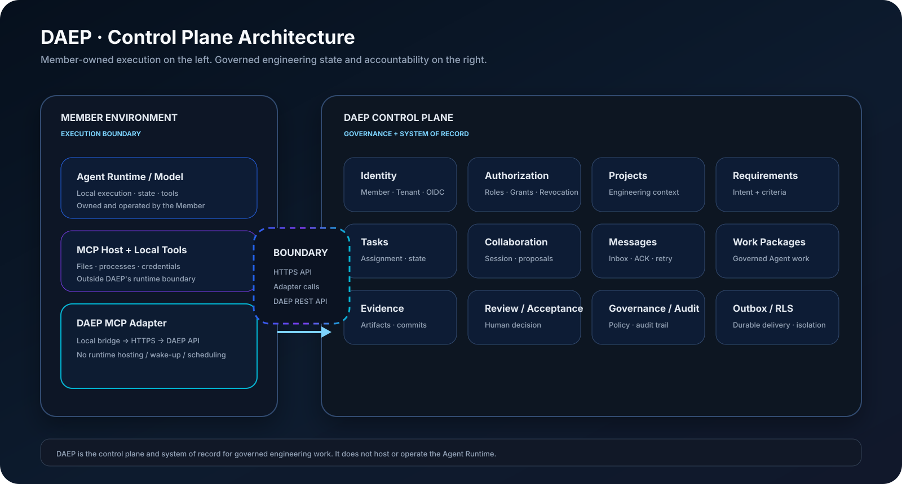
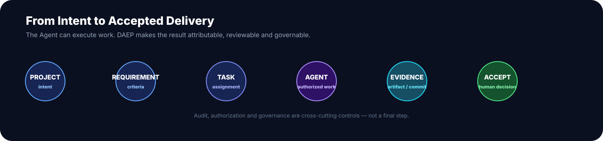

# DAEP

**Distributed Agentic Engineering Platform｜分布式 Agent 工程协作平台**

DAEP 是一个面向团队的 **Agentic Engineering 软件工程协作与治理平台**。它把 **Project → Requirement → Task → Evidence → Acceptance** 工程链路，与人类成员、成员自己的 Local Agent、授权、Multi-Agent Collaboration、可靠消息、交付证据、审批、治理和审计连接起来。

**DAEP 的核心定位：Agentic Engineering Control Plane，而不是 Agent Runtime。**

DAEP 不创建、不托管、不启动、不停止、不唤醒用户的 Agent Runtime。每个 Agent 始终归属于一个人类 Member，并运行在该成员自己的环境中；DAEP 负责身份、授权、任务、协作上下文、消息、证据、审批、治理和审计。

> **Language / 语言**
>
> 🇨🇳 [中文 README](README.zh-CN.md)  
> 🇬🇧 [English README](README.en.md)

## 一眼看懂 DAEP / DAEP at a Glance



DAEP is not an Agent Runtime. It is the control plane that connects **human accountability → explicit authorization → governed Agent execution → evidence → human acceptance → audit**.



## 产品价值 / Product Value

DAEP 解决 Agentic Engineering 中传统项目管理工具难以解决的问题：

- **责任清晰 / Accountability**：任务首先归属于人类 Member，Agent 在明确授权后参与执行。
- **权限可控 / Authorization**：Agent 权限来自 Owner 授权，而不是来自 Presence 或项目成员身份。
- **协作可治理 / Governed Collaboration**：多个 Agent 可以围绕同一 Task 协作，但不会直接争写 Task 总体状态。
- **证据可验证 / Evidence-based Delivery**：Agent 结果进入 REVIEW，交付必须有 Artifact / Commit 等证据。
- **人类最终验收 / Human Acceptance**：Requirement 必须经过明确的验收标准验证和人类审批。
- **可靠消息 / Reliable Delivery**：Inbox、Outbox、ACK、Retry、Dead Letter、Recovery 均可追踪。
- **全链路审计 / Auditability**：授权、协作、交付、审批、治理和消息状态均可审计。

## 产品边界 / Product Boundary

```
Member Environment                         DAEP Control Plane
┌──────────────────────────┐              ┌──────────────────────────┐
│ Agent Runtime / Model    │              │ Identity & Authorization │
│ Tools / Local Files      │              │ Projects / Requirements  │
│ MCP Host                 │── Adapter ──▶│ Tasks / Collaboration     │
│                          │    HTTPS     │ Evidence / Approval       │
└──────────────────────────┘              │ Messaging / Outbox        │
                                          │ Governance / Audit        │
                                          └──────────────────────────┘
```

DAEP **不负责 / does not**：

- 创建或托管 Agent Runtime；
- 启动、停止、唤醒 Agent；
- 接管 Agent 的本地工具、文件或模型；
- 因 Agent Presence 自动授予业务权限；
- 让 Agent Proposal 绕过人类审批；
- 把 Project 本身作为 Agent 的 Owner。

## 核心能力 / Core Capabilities

| 能力 | Capability |
|---|---|
| Project / Requirement / Task | 工程工作管理 |
| Agent Ownership & Authorization | Agent 归属与授权 |
| Multi-Agent Collaboration | Task 级多 Agent 协作 |
| Work Packages | 可治理的 Agent 子任务 |
| Artifacts & Evidence | 交付证据 |
| Review & Acceptance | 人类评审与验收 |
| Durable Inbox / Outbox | 可靠消息与投递 |
| Governance & Audit | 治理与审计 |
| PostgreSQL RLS / OIDC | 多租户与安全边界 |
| MCP Adapter | 成员本地 Agent 接入 |

## 快速开始 / Quick Start

```bash
cp .env.example .env
docker compose -f docker-compose.rc8.yaml up --build -d
```

访问：

- Dashboard: `http://localhost:8000/`
- API Docs: `http://localhost:8000/docs`
- Health: `http://localhost:8000/health`

Broker Worker 可选：

```bash
docker compose -f docker-compose.rc8.yaml --profile broker up --build -d
```

生产部署使用 `compose.production.yaml`，并遵循部署验收与生产运维文档。

## 技术栈 / Technology

**Python / FastAPI · PostgreSQL 17 + RLS · Alembic · OIDC · MCP Adapter · Transactional Outbox · Docker Compose**

## 当前状态 / Current Status

DAEP 当前处于 **Release Candidate / 持续开发阶段**。核心产品链路已经覆盖项目管理、Agent 授权、多 Agent 协作、Work Package、交付证据、人类审批、可靠消息、治理与审计。

RC 不等于 Production GA。真实生产环境仍需完成 PostgreSQL、OIDC、TLS、Broker/Git 集成、备份恢复、安全评审、负载及灾备演练等部署方验收。

## 文档 / Documentation

- [中文完整 README](README.zh-CN.md)
- [English full README](README.en.md)
- [项目交接 / Project Handoff](docs/PROJECT_HANDOFF.md)
- [部署验收 / Deployment Acceptance](docs/DEPLOYMENT_ACCEPTANCE_CHECKLIST.md)
- [PostgreSQL / OIDC / Tenancy](docs/POSTGRES_OIDC_TENANCY.md)
- [Outbox Worker](docs/OUTBOX_WORKER.md)
- [Production Operations](docs/RC21_PRODUCTION_OPERATIONS.md)
- [Security & Gaps](docs/SECURITY_AND_GAPS.md)
- [MCP Adapter](daep_mcp/README.md)

## License

See the repository license file.
