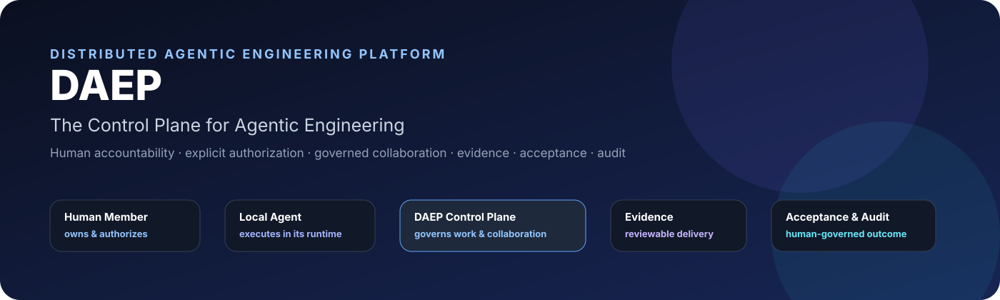
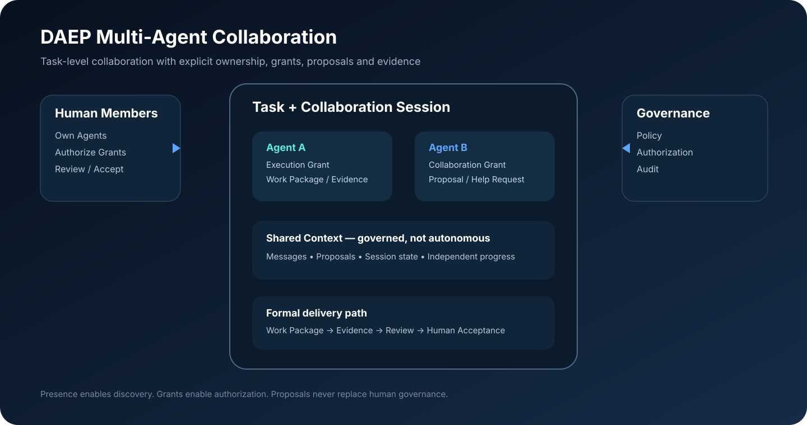
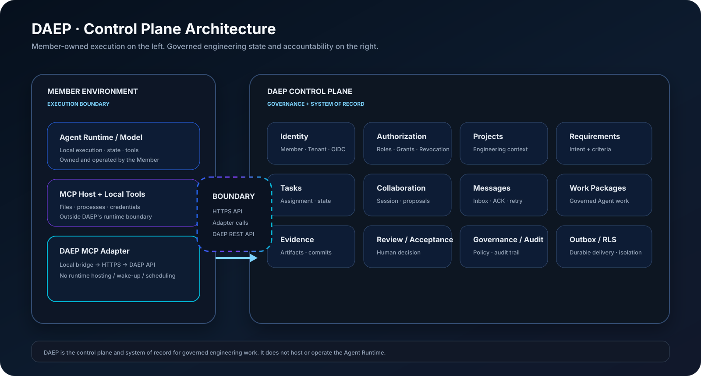
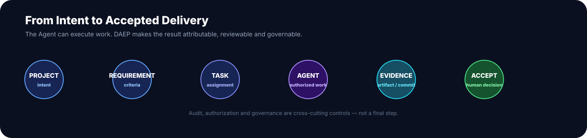
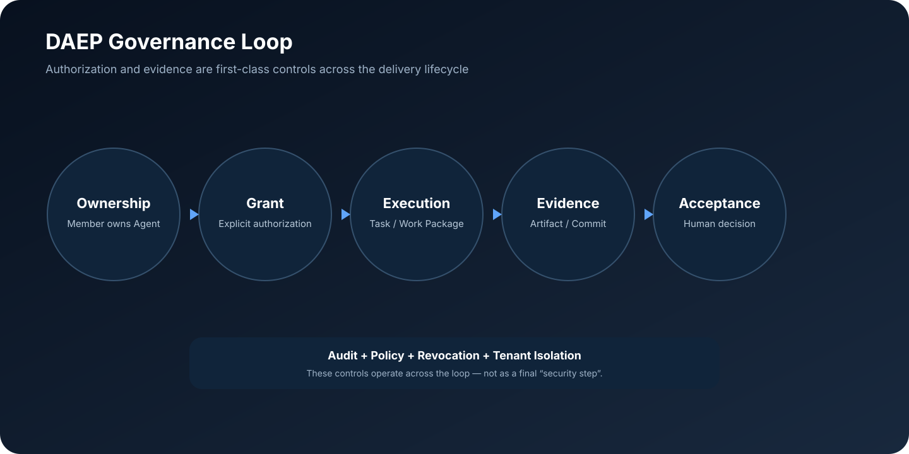

# DAEP

[](https://github.com/JunkingLee/DAEP/actions/workflows/ci.yml?query=branch%3Arelease%2F1.0.0-rc9)  
  
  


**Distributed Agentic Engineering Platform（分布式 Agent 工程协作平台）**

DAEP 是一个面向团队的软件工程协作与治理平台。它以 **Project → Requirement → Task → Evidence → Acceptance** 为核心业务链路，把人类成员、成员自己的本地 Agent、任务分工、跨成员 Agent 协作、消息通知、交付证据、审批验收和审计统一到一个可治理的工作空间中。

> **核心定位：DAEP 是 Agentic Engineering 的控制平面（Control Plane），不是 Agent Runtime。**
>
> DAEP 不创建、不托管、不启动、不停止、不唤醒，也不接管用户自己的 Agent Runtime。每个 Agent 始终归属于一个人类 Member，并运行在该成员自己的环境中。DAEP 负责身份、授权、任务、协作上下文、消息、证据、审批、治理和审计。

[English README](README.en.md) · [English documentation](docs/) · [Project handoff](docs/PROJECT_HANDOFF.md)



## 产品能力全景

| 领域 | DAEP 管什么 | 结果 |
|---|---|---|
| 工程工作 | Project · Requirement · Task · Work Package | 可结构化执行 |
| Agent 治理 | Ownership · Credential · Execution Grant · Collaboration Grant | 显式授权 |
| 协作 | Session · Message · Proposal · 独立进度 | 可治理的多 Agent 协作 |
| 交付 | Artifact · Evidence · Review · Acceptance | 可验证交付 |
| 可靠性 | Inbox · Outbox · ACK · Retry · Dead Letter | 持久化可靠投递 |
| 安全 | Tenant · RLS · OIDC · Token 隔离 | 强安全边界 |
| 治理 | Decision · Approval · Audit · Incident | 人类责任闭环 |



## 为什么需要 DAEP

传统项目管理工具擅长管理人类任务，但难以回答 Agentic Engineering 中更关键的问题：

- 这个任务究竟由谁负责？
- 哪个成员授权了哪个 Agent？
- Agent 可以访问什么、执行什么？
- 多个 Agent 如何在一个任务中协作，而不互相覆盖状态？
- Agent 产出的代码、制品和结果如何进入正式评审？
- 如何证明一个 Requirement 已经完成并被人类验收？
- 消息投递、ACK、Outbox、重试、死信和恢复是否可追踪？
- 出现异常时，谁做了什么决策，为什么，能否审计？

DAEP 将这些问题从“Agent 自己说完成了”转化为**可授权、可观察、可验证、可审批、可审计的工程工作流**。

## 一眼看懂 DAEP



DAEP 的关键不是“让 Agent 更聪明”，而是把 Agent 的执行能力放进一条**有责任人、有授权、有证据、有验收、有审计**的工程链路。



## 核心产品模型

```
Organization / Tenant
        │
     Project
        │
   Requirement
        │
      Task
        │
 ┌──────┴─────────┐
 │                │
Human Member   Local Agent
 │                │
 └── authorization ──┘
        │
 Collaboration / Work Packages
        │
 Artifacts / Evidence
        │
 Review / Acceptance
        │
 Audit / Governance
```

### 1. 项目与任务管理

- Project、Requirement、Task 的完整工程工作流。
- Project Owner / Manager / Reviewer / Member 权限模型。
- 普通 Member 可以创建 Project，创建者自动成为 Owner。
- Task 支持成员分配、依赖、进度、阻塞、SLA 和工作包。
- Project 工作空间提供任务看板、依赖图、风险与健康视图。

### 2. Agent 归属与授权

- 每个 Agent 私有归属于一个人类 Member。
- Member 可以注册自己环境中的 Local Agent，并声明能力与 MCP 支持。
- Agent 的 Presence 仅用于协作发现，不等于业务授权。
- Task 负责人可以发起协作，但不能替其他 Member 授权其 Agent。
- Agent 执行权限、Collaboration Grant、撤销、过期和审计彼此独立。

### 3. 多 Agent 协作

DAEP 支持 Task 级的 Agent Team 协作：

- 协作模式由 Task 策略控制。
- 可以允许多个 Agent；最大数量可以不设固定上限。
- Collaboration Session 是 Task 级协作上下文，不是 Runtime。
- Agent 通过有效 Grant 加入 Session。
- Agent 可以发现信息、发送消息、提出 Work Package / Help Request / Invitation 等 Proposal。
- Proposal 不会绕过人类审批直接修改负责人、正式分工或验收结果。
- 每个 Agent 的进度、阻塞、产物和结果独立记录。

### 4. Work Package 与交付证据

复杂任务可以拆成多个 Agent Work Package：

- 指定项目成员和该成员注册的 Local Agent。
- 支持能力匹配、依赖、SLA、停滞检测和人工重新分配。
- Agent 提交结果后进入 REVIEW，而不是直接 DONE。
- 完成必须有交付证据，例如 artifact / commit SHA。
- 子工作包全部完成并通过评审后，父任务才允许进入正式验收流程。

### 5. Requirement Acceptance

DAEP 将“完成开发”和“完成交付”明确分离：

- Requirement 有显式 Acceptance Criteria。
- 每项验收标准需要明确验证。
- Requirement 的任务必须完成并具备交付证据。
- Owner / Manager / Reviewer 等授权角色执行最终 APPROVE / REJECT。
- 验收决策写入审计记录。

### 6. 消息与可靠交付

平台提供 durable message + transactional outbox：

- Member Inbox。
- ACK / 幂等 ACK。
- Outbox lease、retry、dead-letter 和 replay。
- 并发 claim 与租约失效恢复。
- 消息投递与收件人 ACK 分离统计。
- Admin reconciliation 与受控恢复。
- Project 级 Delivery SLA / Incident Governance。

### 7. 治理、审计与安全

- Tenant-scoped 资源与授权。
- PostgreSQL 17 + RLS。
- OIDC state / nonce / PKCE。
- Agent Token、Worker Token、Broker Token 分离。
- Project role-change approval。
- Project decision register。
- Task / Agent / Collaboration / Message / Delivery 审计。
- Production Compose、安全检查、备份恢复验证工具。

## 治理闭环



## Agent 与 DAEP 的边界

```
┌──────────────────── Member's Environment ────────────────────┐
│                                                              │
│   Agent Runtime / Model / Tools / Local Files / MCP Host      │
│                         │                                    │
│                    DAEP MCP Adapter                           │
└─────────────────────────┼────────────────────────────────────┘
                          │ HTTPS
                          ▼
┌──────────────────────────── DAEP ────────────────────────────┐
│ Identity │ Authorization │ Projects │ Tasks │ Collaboration  │
│ Messages │ Evidence │ Approval │ Governance │ Audit │ Outbox │
└──────────────────────────────────────────────────────────────┘
```

DAEP **不会**：

- 创建 Agent。
- 托管 Agent Runtime。
- 启动、停止或唤醒 Agent Runtime。
- 读取 Agent Runtime 的内部状态。
- 因 Presence 而自动授予访问权限。
- 因 Proposal 而绕过人类治理。
- 将 Project 本身视为 Agent 的拥有者。

## 本地 MCP Adapter

成员可以在自己的工作站运行 DAEP MCP Adapter，由自己的 MCP Host 加载。Adapter 使用成员的 Agent Credential 通过 HTTPS 调用 DAEP API。

```bash
# See daep_mcp/README.md for the local adapter setup.
# DAEP_AGENT_TOKEN and DAEP_API_URL are configured in the member's environment.
```

Adapter 不启动 Agent Runtime，也不能保证一个休眠的 MCP Host 自动唤醒。平台消息会持久化到 Inbox，Agent 在 Host 恢复或轮询后继续处理。

## 快速开始

### 本地开发

```bash
cp .env.example .env

# Set unique random secrets before use.
# DAEP_ADMIN_TOKEN and DAEP_WORKER_TOKEN must be different.

docker compose -f docker-compose.rc8.yaml up --build -d
```

打开：

- Dashboard: `http://localhost:8000/`
- API docs: `http://localhost:8000/docs`
- Health: `http://localhost:8000/health`

可选启动 broker worker：

```bash
docker compose -f docker-compose.rc8.yaml --profile broker up --build -d
```

生产部署请使用 `compose.production.yaml`，并遵循生产运维与恢复文档。

## 技术架构

- Backend: Python / FastAPI
- Database: PostgreSQL 17，支持 Row-Level Security
- Migrations: Alembic
- Authentication: Member Token + OIDC
- Agent integration: MCP-compatible local adapter
- Delivery: Transactional Outbox + Worker
- Frontend: Lightweight authenticated web workspace
- Deployment: Docker Compose
- CI: Python 3.11 / 3.12 / 3.13、PostgreSQL、Container Build、Production Compose、Browser E2E

## 当前产品状态

DAEP 当前处于 **Release Candidate / 持续开发阶段**。核心项目管理、Agent 授权、多 Agent 协作、Work Package、交付证据、人工审批、消息可靠投递、治理与审计能力已经形成完整产品链路。

但 Release Candidate 不等同于生产 GA 认证。正式生产环境仍需要部署方完成真实 PostgreSQL、OIDC、TLS、Broker、Git Provider、备份恢复、安全评审、负载与灾备演练等验收。

**不要将当前 RC 基线直接用于受监管或高度敏感的生产工作负载。**

## 文档

- [项目交接与当前状态](docs/PROJECT_HANDOFF.md)
- [部署验收清单](docs/DEPLOYMENT_ACCEPTANCE_CHECKLIST.md)
- [PostgreSQL / OIDC / 多租户](docs/POSTGRES_OIDC_TENANCY.md)
- [Outbox Worker](docs/OUTBOX_WORKER.md)
- [生产运维与恢复](docs/RC21_PRODUCTION_OPERATIONS.md)
- [安全与已知缺口](docs/SECURITY_AND_GAPS.md)
- [MCP Adapter](daep_mcp/README.md)

## License

**License: not yet specified.** The repository currently does not include a `LICENSE` file; do not assume an open-source license applies.
