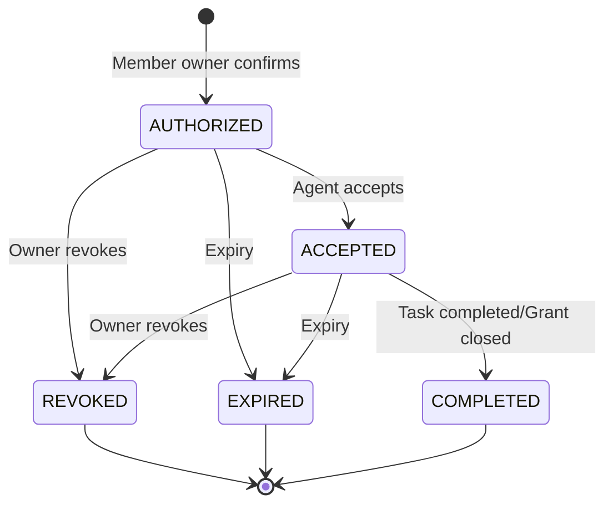

# Agent 用户所有权模型：数据库与 API 迁移设计

> 状态：迁移设计基线（2026-11-24）
> 适用分支：release/1.0.0-rc9
> 依据：docs/DOMAIN_MODEL_AGENT_OWNERSHIP.md
>
> 本文定义从现有 Agent Project Binding / Agent Task Assignment 迁移到用户主动授权、逐任务 AgentTaskGrant 的兼容方案。本文本身不执行数据库迁移，不改变线上行为。

## 1. 迁移目标和不变量

目标不是让 Agent 成为 Project 的成员，而是让任务的人类责任人主动授权自己的 Agent 在该任务上执行有限操作。

必须成立：

1. Agent 只有一个 owner：agents.owner_member_id。
2. 人类任务责任人（Human Assignee）始终是 Member；Agent 不替代该责任人。
3. Manager/Owner 负责分配任务给 Member；只有 Agent owner 且当前任务责任人本人可以授权自己的 Agent。
4. Agent Token 只认证 Agent，不继承 owner 的 Member Token、项目角色或管理权限。
5. Agent 的每次任务读取/写入都必须由服务端检查有效 AgentTaskGrant；不得再要求或依赖 agent_project_bindings。
6. ProjectAgentPresence 是发现信息，不是权限来源。
7. 旧 assignment/binding 数据不能自动等价为新授权；迁移必须可审计、可回滚、不能扩大权限。

## 2. 当前代码事实与问题

### 2.1 当前表

| 表 | 当前字段/用途 | 问题 |
|---|---|---|
| agents | id、owner_member_id、tenant_id、status 等 | 所有权方向正确，保留 |
| agent_tokens | agent_id、token_hash、status、expires_at 等 | Agent 身份认证正确，保留 |
| agent_project_bindings | project_id、agent_id、tenant_id、role、work_function、status | 把 Agent 和项目建立长期绑定；被 MCP Context、项目访问和任务执行流程当成授权前置 |
| agent_task_assignments | task_id、project_id、agent_id、tenant_id、assigned_by_member_id、status、accepted_at 等 | 缺少 human_assignee_member_id、owner 授权证据、scope、expires_at；Manager 分配 Agent 后 Agent 可接受 |
| project_agents | project_id、member_id、agent_name、capabilities、protocols、status、last_seen | 本质是成员本地 Agent 能力/在线状态目录，但用名称作为身份键，未稳定关联 agents.id |
| task_delegations | requester_member_id、recipient_member_id、agent_name 等 | 人对人任务委派流程，不应改作 Agent 授权表 |

### 2.2 当前关键 API 路径

| API/函数 | 当前行为 | 目标行为 |
|---|---|---|
| POST /api/v1/agents/{agent_id}/projects | Agent owner 绑定项目，当前还要求调用者具备项目 Owner/Manager 角色 | 逐步废弃为授权入口；可替换为 Agent owner 自主发布/撤回 Presence 的接口 |
| DELETE /api/v1/agents/{agent_id}/projects/{project_id} | 项目 Manager/Owner 可解绑并撤销该 Agent 在项目内任务分配 | 不再允许项目解绑隐式撤销个人任务授权；由 owner 撤销单个 Grant，任务/项目关闭按规则失效 |
| POST /api/v1/tasks/{task_id}/agent-assignments（当前任务分配路由） | 项目 Manager/Owner 选择 Agent，要求已有 project binding | 改为 Member owner 在自己负责的任务上授权自己的 Agent；Manager 不可代选私人 Agent |
| GET /api/v1/tasks/{task_id}/agent-assignments | 项目成员可查看任务 Agent assignment | 改为项目成员按项目审计权限查看有限授权摘要；私有 Agent 凭证和配置不可见 |
| POST /api/v1/agent-assignments/{id}/accept | Agent 接受旧 assignment，并检查项目 binding | Agent 接受自己收到的有效 Grant；不再检查项目 binding |
| POST /api/v1/agent-assignments/{id}/heartbeat | 更新旧 assignment 活动时间，并检查项目 binding | 对应 Grant heartbeat/lease；每次检查 Grant、Agent、Task、Project、Tenant 状态 |
| GET /api/v1/agents/me/tasks | 通过 assignment + active project binding 返回任务 | 只返回当前 Agent 有效且已接受的 AgentTaskGrant 对应任务 |
| require_project_access / require_task_access | Agent 先要通过项目 binding，再检查 accepted assignment | Agent 不走通用项目成员授权；任务读取/写入直接校验 Grant 和 allowed_actions |
| GET /api/v1/mcp/context | 返回 Agent 已绑定项目 | 返回 Agent 身份和非授权性能力信息；不得将 project 列表当成权限范围 |

注：当前任务分配路由的实际路径应以代码路由声明为准；改造前需将它的 decorator 和 OpenAPI 路径加入迁移测试，避免文档路径与实现不一致。

## 3. 目标实体：agent_task_grants

建议新增独立表，不直接重命名旧表。旧表保留为历史兼容数据，降低一次性迁移风险。

### 3.1 字段

| 字段 | 类型建议 | 必需 | 含义 |
|---|---|---:|---|
| id | TEXT PK | 是 | Grant 唯一 ID |
| tenant_id | TEXT | 是 | Tenant 安全边界 |
| project_id | TEXT FK | 是 | Task 所属项目冗余键，用于隔离和索引 |
| task_id | TEXT FK | 是 | 被授权的任务 |
| agent_id | TEXT FK | 是 | 被授权的 Agent |
| owner_member_id | TEXT FK | 是 | 创建时 Agent owner 快照 |
| human_assignee_member_id | TEXT FK | 是 | 创建时任务的人类责任人快照 |
| authorized_by_member_id | TEXT FK | 是 | 实际发起授权的 Member，必须等于 owner 和当前 assignee |
| scope_json | TEXT/JSONB | 是 | 明确允许的动作与字段范围 |
| status | TEXT | 是 | AUTHORIZED / ACCEPTED / REVOKED / COMPLETED / EXPIRED |
| created_at | timestamp/text | 是 | 授权时间 |
| updated_at | timestamp/text | 是 | 最近状态变更 |
| expires_at | timestamp/text | 是 | 必须有期限；默认 30 天，最长 90 天 |
| accepted_at | timestamp/text | 否 | Agent 接受时间 |
| revoked_at | timestamp/text | 否 | 撤销时间 |
| completed_at | timestamp/text | 否 | 任务授权完成时间 |
| revoked_by_member_id | TEXT FK | 否 | 撤销者；成员撤销时记录 |
| revoke_reason | TEXT | 否 | 撤销原因 |
| last_activity_at | timestamp/text | 否 | Agent 最近一次有效操作 |
| legacy_assignment_id | TEXT | 否 | 若经人工确认迁移，保留来源记录 |

### 3.2 状态机

- AUTHORIZED：人类责任人已授权，Agent 尚未接受。
- ACCEPTED：Agent 已接受，才可调用执行类工具。
- REVOKED / EXPIRED / COMPLETED：终态，不可复活；需要重新授权时创建新 Grant。
- Task 或 Project 被关闭、任务不再分配给授权人、Agent 停用、owner 账户停用、Token 撤销等情形，应阻断后续操作。撤销/过期原因写审计事件。
- Agent Token 撤销不必篡改 Grant 的历史状态，但任何请求必须因凭证失效而拒绝；Token 再次轮换后是否允许旧 Grant 继续使用，需要产品策略明确。建议默认：Token 轮换保留 Grant，显式撤销 Agent/禁用 Agent 才撤销 Grant。

### 3.3 Scope

第一版仅开放固定白名单，不允许客户端提交任意 API 权限：

- task.read：读取指定任务的标题、描述、状态、必要的验收标准和依赖摘要；隐藏项目成员、其他任务、内部治理数据、敏感附件。
- task.progress.report：提交执行进度（0–99），不直接任意修改任务状态。
- task.blocked.report：报告阻塞原因和需要协助的信息。
- task.artifact.submit：上传/提交任务产物到该任务；不等于正式交付验收。
- task.comment.create：仅在现有评论接口确实支持 Agent 安全身份和任务作用域后开放；否则第一版不开放。

明确禁止：任务 reassignment、任务删除、项目读写、项目成员管理、角色变更、审批/验收、风险关闭、质量规则修改、Grant 管理、其他任务访问。

服务端应将 scope 解析为枚举集合并逐接口校验，不可用字符串子串判断。默认 scope 固定为上述允许项的子集。

### 3.4 约束与索引

- FK/复合一致性校验保证 tenant_id、project_id、task_id、agent_id 关系一致。
- 检查 owner_member_id = agents.owner_member_id；创建时快照，使用时还要复核当前 owner。
- 检查 human_assignee_member_id = 当前 assignments 表中有效的任务人类责任人。
- 默认同一 task 同一时刻最多一个 ACCEPTED Grant；是否允许 AUTHORIZED 并存多个候选 Agent，由第一版 UI 决策。建议同一任务仅允许一个 ACTIVE Grant（AUTHORIZED/ACCEPTED），避免两个 Agent 并发改写同一任务。
- partial unique index：task_id WHERE status IN ('AUTHORIZED','ACCEPTED')。
- 查询索引：(tenant_id, agent_id, status, expires_at)、(tenant_id, task_id, status)、(owner_member_id, status, created_at)。
- PostgreSQL ENABLE + FORCE RLS，policy 使用现有 daep_tenant_visible(tenant_id)；应用 DB role 只能在已建立 tenant context 后访问。Agent credential lookup role 不授予该表权限；Agent 通过正常请求上下文和业务 SQL 访问。

## 4. 创建与执行授权流程

### 4.1 创建 Grant（由 Member 主动发起）

推荐 API：POST /api/v1/tasks/{task_id}/agent-grants

Request:
- agent_id
- requested_scope（可选，只能从固定白名单选）
- expires_in_days（可选，默认 30，最大 90）

服务端必须在同一事务中：
1. actor 必须是 MEMBER，不允许 AGENT Token。
2. 解析 task → requirement → project → tenant。
3. 校验 Project ACTIVE 且与当前 Member tenant 一致。
4. 校验 Member 是当前任务人类 assignee（从正式 assignments/assignee 关系读取，不能信任 body 的 member_id）。
5. 校验 Agent 存在、ACTIVE、tenant 相同且 owner_member_id = 当前 Member。
6. 校验不存在同 Task 的其他有效 Grant；若存在返回 409，并提供可撤销的当前授权摘要（不泄露其他用户 Agent 私密数据）。
7. 创建 AUTHORIZED Grant，scope 固定白名单，expires_at 有上限。
8. 写审计事件 agent.task_grant.authorized，actor_member_id 是授权人，payload 包含 agent_id/task_id/grant_id/scope/expiry。
9. 返回 Grant 和 Agent 展示名；不返回 Token。

不需要 project binding，也不需要 Project Manager 再次批准；成员本身已经是任务责任人，并且只能授权自己的 Agent。

### 4.2 Agent 接受 Grant

推荐 API：POST /api/v1/agent-grants/{grant_id}/accept

- actor 必须是 Agent。
- grant.agent_id 必须等于 actor.agent_id。
- grant.status 必须是 AUTHORIZED 且未过期。
- 再次验证 Agent ACTIVE、owner Member ACTIVE、Task 当前仍由 grant.human_assignee_member_id 负责、项目 ACTIVE、Tenant 一致。
- 更新为 ACCEPTED，写 accepted_at 和审计事件。
- 重复接受可幂等返回 ACCEPTED；已撤销/过期/已完成返回 409。

### 4.3 Agent 获取任务

推荐 API：GET /api/v1/agents/me/tasks

- 只查询当前 agent_id 的 AUTHORIZED/ACCEPTED 未过期 Grant。
- 为保持接受语义，Agent inbox 可以看到 AUTHORIZED 的最小邀请摘要；执行详情只对 ACCEPTED 返回。
- 不 JOIN agent_project_bindings。
- 不返回 requirement 全量、项目成员、其他任务、内部质量/风险或治理数据。
- 返回 grant_id、task_id、最小 task fields、scope、expires_at、grant status。

### 4.4 执行工具

所有 MCP 工具最终落到 API 时调用统一函数，例如 assert_agent_task_grant(c, actor, task_id, action)。

统一校验顺序：
1. actor_type=AGENT，Agent Token 有效。
2. 以 agent_id + task_id + tenant_id 查 Grant。
3. Grant.status=ACCEPTED 且 expires_at > now。
4. Agent ACTIVE、owner Member ACTIVE。
5. Task/Project 存在、同 Tenant、Project ACTIVE、Task 未进入不可执行终态。
6. 当前任务人类 assignee 仍等于 Grant.human_assignee_member_id 和 Agent owner。
7. scope_json 包含本次 action。
8. 再执行具体业务写入；写审计事件时记录 Agent actor，不冒充 owner Member。

对 task detail / progress / blocked / artifact submit 分别做字段级过滤和 action 校验。禁止 Agent 复用 Member 的宽权限 task update 或 review API。

### 4.5 撤销

推荐 API：
- DELETE /api/v1/agent-grants/{grant_id}（owner Member）
- POST /api/v1/agent-grants/{grant_id}/revoke（若项目 API 规范要求显式动作）

校验：
- 当前 Member 必须是 owner_member_id、human_assignee_member_id 和 authorized_by_member_id 对应的授权人；至少保证当前仍为该任务责任人。
- 项目 Manager 可以查看审计摘要，但不得替用户撤销个人 Agent Grant。任务被取消/项目关闭等治理动作可以使 Grant 自动失效，但必须记录 system-triggered reason。
- Agent 不得自行撤销或扩大自己的 Grant。

## 5. 现有表的迁移策略

### 5.1 agents / agent_tokens

- 原样保留，不更改 owner_member_id 的业务含义。
- 增加/补充约束：Agent tenant 与 owner Member tenant 必须一致（需要先检查并修复历史不一致记录）。
- Agent 停用或 owner 停用时，所有有效 Grant 失效。
- Token rotate：仅替换凭证，不改变 Agent 所有权；Token revoke 立即阻断 Agent 请求。

### 5.2 agent_project_bindings

阶段一（兼容期）：
- 保留表和历史行，不再将其作为创建 Agent Grant 的前置条件。
- 新 Grant 访问不检查 binding；Agent task inbox 和执行 API 也不 JOIN binding。
- MCP Context 不再把绑定项目列表表达成授权范围；可以返回空的 authorized_projects 或改成只返回 Agent identity/capabilities。
- UI 将“绑定到项目”入口从 Agent 管理核心流程移除，避免继续误导用户。

阶段二（替代）：
- 若确实需要项目 Agent 可发现性，由 Agent owner 对每个 Project 主动开启 ProjectAgentPresence。
- Presence 仅用于项目成员发现 Agent 能力/在线状态，不提供任务权限；撤回 Presence 不撤销既有 Grant。
- 项目 Manager 不能创建或删除其他成员的 Presence，也不能读取 Token。
- 完成数据备份、调用方清点和旧版本兼容验证后，再停止写入旧 binding 表。

阶段三（删除）：
- 只有确认没有运行时代码、报表、外部集成和回滚版本依赖后，才新增 migration 删除旧表；不在第一轮迁移中 DROP。

### 5.3 agent_task_assignments

不能直接把旧表重命名为新 Grant，因为它缺少关键授权证据。

迁移策略：
- 新建 agent_task_grants，所有新授权走新表。
- 旧表保留，标记为 legacy assignment history；停止新写入。
- 对旧表 ACTIVE（ASSIGNED/ACCEPTED）记录，不自动复制为 ACCEPTED Grant。旧数据可能由项目 Manager 创建，无法证明 Agent owner 对具体任务做过明确授权。
- 切换执行 API 到新表时，旧表中仍活跃的 assignment 应在同一维护窗口被标记 REVOKED，reason='migrated_to_owner_grant_model'，写审计事件；保留原 assignment_id、时间和 actor 供审计。
- 已完成/已撤销历史行原样保留。
- 如业务确实要求无中断过渡，只能由 Agent owner 在 UI 对历史任务重新确认，生成新 Grant；不得后台静默继承。

### 5.4 project_agents

- 先保留现有能力/心跳数据。
- 新增 nullable agent_id FK，不能立即设 NOT NULL。
- 回填只允许在 project_id + member_id + normalized agent_name 对应到唯一 ACTIVE Agent 时自动关联。
- 同一成员同名多个 Agent、历史 owner 已不存在、Tenant 不匹配、无精确唯一匹配的行保持 agent_id=NULL，标记为 legacy/unmatched，等待 owner 重新发布 Presence。
- 不得仅凭 display name 跨成员或跨 Tenant 自动匹配。
- 新写入 Presence 时必须由 Agent owner 认证，并将 agent_id、member_id=agents.owner_member_id、tenant_id=agents.tenant_id、project_id 的关系在服务端验证。
- Presence 删除/过期不撤销 AgentTaskGrant。

### 5.5 task_delegations

- 不迁移、不改语义；继续作为 Member → Member 的人对人任务委派流程。
- 接收成员接受任务后成为 Human Assignee，再由该成员授权自己的 Agent。
- task_delegations.agent_name 不应再被解释为 Agent 安全身份；后续可弃用该提示字段或仅保留为历史展示文本。

## 6. API 和前端迁移顺序

阶段 A：先加新能力，不破坏旧能力
1. 新增 AgentTaskGrant schema/migration、RLS 和索引。
2. 新增 Member 创建/查看/撤销 Grant API。
3. 新增 Agent inbox/accept/heartbeat API。
4. 增加统一 Grant 校验器和 API 单元测试；此时旧 assignment API 可继续运行，但标记 legacy。

阶段 B：切换 Agent 执行权限
1. Agent task list、task detail、progress、blocked、artifact submit 全部改为 Grant 校验。
2. MCP 工具改用新 Grant API/路径。
3. 不再要求 project binding。
4. 对旧 ACTIVE assignment 做有审计的撤销，旧表只读。
5. 删除 Agent 通过通用 project access 读取项目或任务的路径。

阶段 C：用户体验
1. 任务详情中仅当前 Human Assignee 显示“使用我的 Agent”。
2. 选择列表只来自 GET /api/v1/agents（owner 自己的 Agent），仅 ACTIVE。
3. 展示明确 scope 和有效期，确认后创建 Grant。
4. 展示 Grant 状态、Agent 名称、最后活动时间；允许授权人撤销。
5. Agent 管理页显示“我的 Agent 当前受托任务”，与 ProjectAgentPresence 分开展示。
6. Manager/Owner 的任务页只展示有限 Agent 执行状态和审计摘要，不出现绑定/接管他人 Agent 的操作。

阶段 D：清理旧模型
1. 旧 binding/assignment 写 API 返回弃用提示或 410（经过客户端迁移期）。
2. 移除 Agent 的项目 binding 权限检查。
3. 旧表进入只读归档，确认回滚窗口关闭后才考虑删除。
4. 更新领域模型、MCP 集成说明、OpenAPI、UI 文案和浏览器 E2E。

## 7. 测试矩阵（必须实现）

### 所有权与授权创建
- Member A 可授权自己的 Agent A1 处理分配给 A 的 Task A。
- Member A 不能授权 Member B 的 Agent。
- Member A 不能授权自己的 Agent 处理分配给 B 的任务。
- Manager 不能替 Member A 创建 Grant，也不能用 Manager 身份绑定 Member A 的 Agent。
- Agent Token 不能创建、撤销或扩大 Grant。
- 任务无 Human Assignee、多人 assignee 不明确或 assignee 变化时拒绝创建/继续执行。

### Grant 执行与隔离
- Agent A1 只能看到自己 Grant 对应任务。
- 将 task_id、project_id、grant_id 替换成其他用户/项目 ID 必须 403/404。
- 同一 Tenant 不同 Project 之间也不能横向读取未授权任务。
- Grant 过期/撤销后读取、progress、blocked、artifact 全部拒绝。
- Agent 停用、owner 停用、Task 关闭、Project 关闭后拒绝。
- scope 不包含某动作时必须拒绝该动作。
- Agent 不可审批、验收、管理项目成员、关闭风险或修改任务责任人。
- Agent 的审计 actor_type=AGENT 且记录真实 agent_id，不伪装 owner。

### 数据库与并发
- PostgreSQL RLS tenant isolation。
- Agent auth lookup role 无 agent_task_grants SELECT 权限。
- 同一 Task 只能存在一个有效 Grant；并发创建仅一个成功。
- 创建、接受、撤销、过期并发只能有一个合法状态转移。
- FK、Tenant/project/task/agent/owner 组合关系一致性。
- SQLite 测试不能代替 PostgreSQL RLS smoke；两者都要执行。

### 浏览器 E2E
- Member A 登录，打开分配给自己的任务，选择 Agent A1，授权。
- Agent A1 通过 MCP inbox 获取任务并接受。
- Agent 更新进度、报告阻塞、提交产物。
- Member A 查看 Agent 产物并继续正式交付流程。
- Manager/Reviewer 完成正式审核。
- Member B 不能看到 A 的私有 Agent，不能撤销 A 的 Grant。
- 撤销 Grant 后 Agent 后续 MCP 工具立即失败。
- 整个流程在真实浏览器 + 临时隔离数据库中执行。

## 8. 需要在实施前锁定的两个产品语义

1. **任务人类责任人唯一性**：当前任务 assignments 可能允许多人协作。第一版建议只有唯一 Human Assignee 可以授权 Agent；如果多人共同承担，需增加明确的 primary/responsible member，而不是任意 assignee 都能给同一任务派 Agent。
2. **Agent 同任务并发数**：第一版建议一个任务同时最多一个有效 Agent Grant，避免多个 Agent 并发修改进度/产物；以后需要多 Agent 协作时再引入 Agent Work Session/子任务拆分，而不是放开同一任务多写入。

## 9. 推荐落地提交拆分

1. docs：提交本迁移设计并更新 handoff。
2. schema：新增 AgentTaskGrant 表、RLS、约束和测试，不切换执行 API。
3. API：Member 创建/查看/撤销 Grant；Agent inbox/accept/heartbeat。
4. execution：统一 Grant 校验并迁移 task read/progress/blocked/artifact。
5. UI/MCP：任务详情授权、Agent 管理视图和 MCP tool 切换。
6. legacy：停止旧 binding/assignment 写入，保留历史，再经独立评估移除旧表。

## 10. 实施前必须确认的代码细节

- Human Assignee 当前数据来源为 assignments 表；需要确认是否允许一个 task 多个 member_id。若允许，第一版强制唯一 assignee 才可授权。
- 当前 Agent 的 require_task_access 分支先调用 require_project_access，后检查 ACCEPTED assignment；必须拆成 Agent 专用 Grant guard。
- Agent progress/blocked/artifact 的各条路由必须逐一盘点，不得只修 /api/v1/agents/me/tasks。
- 当前 Agent 任务分配 API 的 OpenAPI 路径和前端调用需要完整检索，按真实代码路由迁移。
- 需要先查询历史数据分布（owner/tenant 不一致、重复 assignment、同任务多人 assignee、项目 binding 与 assignment 的组合），再决定 migration 是否需要数据修复脚本。
