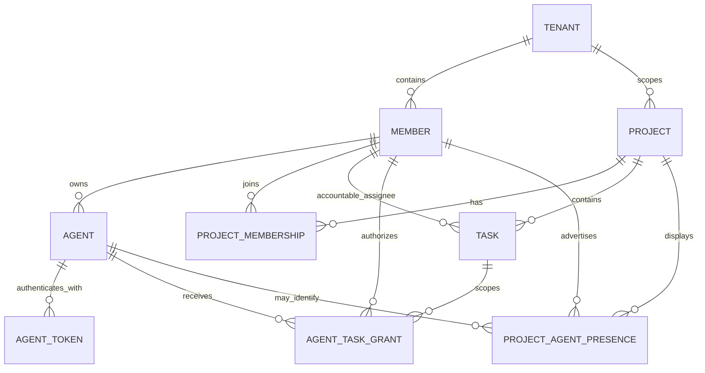

# DAEP 领域模型：用户拥有 Agent、项目承载任务协作

> 状态：领域模型基线（2026-11-23）
>
> 本文是 Agent、Project、Task、MCP 身份与授权设计的统一依据。与旧文档中“项目绑定 Agent”“项目 Agent 目录”等表述冲突时，以本文定义的实体边界和授权不变量为准。本文先统一业务语义，不代表数据库迁移或接口改造已经完成。

## 1. 核心原则

**Agent 的唯一业务所有者是用户（DAEP Member）。项目不是 Agent 的所有者，也不拥有 Agent。**

- 用户创建、拥有、配置、启用/停用自己的 Agent，并管理该 Agent 的 MCP 凭证。
- Tenant 是安全隔离边界；用户和 Agent 均属于一个 Tenant。Agent 的 tenant 必须与 owner member 的 tenant 一致。
- Project 是团队协作和工作治理空间，拥有任务、成员关系、角色、审核流程和审计记录；不拥有 Agent。
- Task 是工作对象，归属于一个 Project，由人类成员负责。Agent 只能在明确授权的任务范围内代表其所有者提供执行协助。
- MCP Token 认证的是 Agent 身份，不是其所有者的完整用户会话；不得把 Agent Token 等同于 Member Token。
- Agent 不因所有者是项目成员、Owner 或 Manager，就自动获得该用户的全部项目权限或治理权限。

## 2. 核心实体与关系

关系解释：

| 实体 | 归属/作用 | 关键约束 |
|---|---|---|
| Tenant | 安全隔离边界 | 所有跨实体关系必须在同一 Tenant 内 |
| Member | 人类用户身份 | 可加入多个 Project；可拥有多个 Agent |
| Agent | 用户拥有的独立执行身份 | 必须有且只有一个 owner_member_id；不能归属 Project |
| AgentToken | Agent 的认证凭证 | 只认证一个 Agent；可轮换、撤销、过期；只存 hash |
| ProjectMembership | 用户参与项目的关系 | 角色属于人类 Member，不授予 Agent 项目治理角色 |
| Project | 团队工作空间 | 管理成员、任务、治理与审核，不拥有 Agent |
| Task | 项目中的工作对象 | 始终由人类成员承担最终责任；Agent 不是项目成员或任务治理角色 |
| AgentTaskGrant | 针对单个任务的 Agent 委派/授权 | 绑定一个 Agent 和一个 Task，记录授权人、范围、期限、状态 |
| ProjectAgentPresence | 可选的项目内 Agent 在线/能力展示 | 只是发现和状态信息，不是授权，不代表项目拥有 Agent |

## 3. 所有权与授权必须分离

### 3.1 Agent 所有权

- 创建 Agent：当前登录 Member 创建，owner_member_id 固定为该 Member。
- 查看、修改、停用、删除（如支持）、Token 轮换/撤销：仅 Agent owner 可执行；平台管理员只允许按明确的平台运维规则进行受审计操作。
- 项目 Owner/Manager 不得因为项目角色而查看其他用户 Agent 的私有配置或读取、轮换、撤销其 Token。
- Agent 不得转移所有权；若未来支持转移，必须作为独立的、双方确认且可审计的所有权转移流程。

### 3.2 项目成员权限

- Project Owner/Manager 管理项目成员、任务分配、项目流程和正式交付审核。
- 普通 Member 可以查看其有权访问的项目任务，并处理分配给自己的任务。
- Project 角色是人类用户的治理角色；Agent 不拥有 owner、manager、reviewer 等角色。
- Manager 可以把任务分配给某个人类 Member，但不能代替该 Member 选择、配置或控制其私人 Agent。

### 3.3 Agent 任务授权

Agent 参与任务必须有独立、明确、可撤销的 AgentTaskGrant。最小授权规则：

1. 任务必须属于一个 Project，且 Project 与 Agent owner 属于同一 Tenant。
2. 默认的个人执行场景：任务当前 assignee_member_id 必须等于 Agent.owner_member_id；由该成员主动选择自己的 Agent 并授权。
3. 若任务由其他成员转交：先完成既有的人对人任务委派/接受流程，使接收成员成为任务责任人；接收成员再选择自己的 Agent。不得因 Manager 指定一个 Agent 名称就绕过 Agent owner 同意。
4. Grant 必须绑定 task_id、project_id、agent_id、agent_owner_member_id、authorized_by_member_id，并记录 scope、status、created_at、expires_at、accepted_at、revoked_at。
5. Grant 的有效期内，Agent 仅能读取该任务所需上下文、提交进度/阻塞信息、提交任务产物；不得读取同项目其他任务、其他成员私有数据、项目成员管理数据或治理审批数据。
6. Agent 的提交是执行记录/候选交付，不自动等于人类正式验收。最终责任人和审核权限仍由项目的人类工作流决定。
7. Agent 停用、Token 撤销、owner 移出 Tenant、任务撤销/关闭、项目关闭或 Grant 撤销时，相关执行授权必须按规则失效。
8. 任何 MCP 工具/API 都必须在服务端校验 Agent 身份、Grant、Task、Project、Tenant 的关系；不能只靠 UI 隐藏按钮或客户端传入的 owner/member id。

## 4. MCP 身份模型

- Member Token：代表人类 Member，受 Member 的项目成员角色与本人权限约束。
- Agent Token：代表某个 Agent，解析出 agent_id、owner_member_id、tenant_id；它不是 owner 的 Member Token。
- Agent Token 不允许调用只面向人类治理的接口，即使 Agent owner 是 Project Owner/Manager 也不例外。
- Agent 访问 Task 必须通过有效 AgentTaskGrant；不得仅凭 Agent 所有者是项目成员、Agent 曾出现在项目目录或历史绑定记录来推断权限。
- 每次 MCP Tool 调用都在服务端按 Agent 身份重新验证 Grant 状态和任务范围。不得把一次 context 响应中的项目列表当作永久授权缓存。
- Token 轮换/撤销、Agent 停用、Grant 撤销都必须及时影响后续 MCP 请求。

## 5. 项目 Agent 目录/在线状态的正确定位

DAEP 可以提供项目内的 Agent 能力与在线状态目录，帮助团队发现成员可用于协作的本地 Agent，但该目录不是“项目拥有的 Agent 池”。

目录记录最多表达：
- 哪位项目成员公开了一个本地 Agent/Runtime；
- 该 Runtime 自报的名称、能力、协议和最近心跳；
- 当前可用性（在线状态只是最近一次心跳，不保证模型进程正在运行）。

目录记录不得表达：
- Project 拥有该 Agent；
- Project Manager 可以管理该 Agent 或其 Token；
- 该 Agent 自动获得项目全部数据访问权；
- 该 Agent 自动接受任务或自动唤醒本地模型。

若保留 project_agents 表，语义应明确为 ProjectAgentPresence（项目范围的能力/在线状态投影），并与第一类 Agent 身份通过稳定 agent_id 关联；不能只用 agent_name 作为安全身份。目录发现仅是 advisory，后续仍需 Agent owner 对具体 Task 授权。

## 6. 人对人委派与人对 Agent 授权是两种不同关系

现有 task_delegations 主要描述 requester_member_id → recipient_member_id 的人对人任务委派/邀请，recipient_member_id 接受后，责任转移或工作包分配按其既有生命周期处理。

它不能替代 AgentTaskGrant：
- 人对人委派：谁成为任务/工作包的人类责任人。
- 人对 Agent 授权：某位人类责任人允许自己的 Agent 在指定任务范围内执行辅助工作。

推荐流程：

1. Manager/Owner 将任务分配给 Member A，或通过现有 delegation 工作流将任务转给 Member A 并由 A 接受。
2. Member A 在任务详情中选择自己的 Agent A1，查看授权范围后确认。
3. DAEP 创建 AgentTaskGrant，并向 Agent A1 的 MCP inbox 提供该任务。
4. Agent A1 接受授权后，在范围内读取任务上下文、更新进度、报告阻塞和提交产物。
5. Member A 检查 Agent 产物并决定是否提交正式交付/请求审核。
6. Owner/Reviewer 按项目现有审核规则进行正式验收。

## 7. 对当前实现的映射与差距

| 当前实现 | 目前语义/问题 | 目标处理 |
|---|---|---|
| agents.owner_member_id | 已正确表达用户所有权 | 保留，作为唯一 Agent owner 依据 |
| agent_tokens.agent_id | 已正确关联 Agent 身份 | 保留，继续严格隔离和撤销 |
| agent_project_bindings | 容易被误解为项目拥有/绑定 Agent，并被用于推导项目上下文 | 不再作为授权依据；评估改为显式 owner consent/presence，最终由逐任务 Grant 控制访问 |
| agent_task_assignments | 直接把 Agent 指派到 Task，但当前授权发起者/owner consent/任务责任人关系需进一步明确 | 演进为或映射到 AgentTaskGrant，增加 owner/authorized_by/scope/expiry 等约束 |
| project_agents | 项目范围的 member + agent_name 能力/心跳目录 | 保留为 presence/discovery 投影；增加稳定 agent_id 关联，不作为执行授权 |
| task_delegations | 人对人的任务委派/邀请 | 保留，与 AgentTaskGrant 分离 |
| /api/v1/agents/me/tasks | Agent 专属任务入口 | 只返回当前 Agent 有效 Grant 指定的任务 |
| /api/v1/mcp/context | 当前返回 Agent 身份和历史 project bindings | 应以身份为主；项目列表仅为非授权展示信息或移除，不能用于推导可访问范围 |
| daep_mcp/server.py | 混有 Agent identity tools、member compatibility tools、项目 Agent 注册/发现工具 | 分清 Agent 工具与 Member 工具；所有执行工具基于 AgentTaskGrant 逐任务授权 |

## 8. 关键业务不变量（必须进入测试）

1. 一个 Agent 恰好属于一个 Member；任何 Project 都不是 Agent owner。
2. Agent.owner_member_id 的 Tenant 必须与 Agent.tenant_id 一致。
3. 一个 Agent Token 只认证一个 Agent，不能隐式认证其 owner 的 Member 身份。
4. Agent 不具有 ProjectMembership，也不能持有 owner/manager/reviewer 等项目角色。
5. 项目成员关系不自动产生 Agent 权限；ProjectAgentPresence 不自动产生 Agent 权限。
6. 普通成员可以授权自己的 Agent 处理分配给自己的任务，不需要项目 Manager 为其“绑定 Agent”。
7. 成员不能授权其他人的 Agent；Project Manager 也不能未经 Agent owner 同意使用私人 Agent。
8. Agent 对任务的访问必须由有效、逐任务、可撤销的 Grant 授权。
9. Agent 不能通过更换 task_id、project_id、owner_member_id 或 assignment_id 越权读取其他任务。
10. Agent 的任务执行权限不包含项目成员管理、角色审批、风险关闭、正式交付验收等人类治理权限。
11. 任务的人类责任人和 Agent 执行身份必须同时可追溯。
12. Token 撤销、Agent 停用、任务关闭、项目关闭和 Grant 撤销必须按定义使执行权限失效。

## 9. 术语统一

| 统一术语 | 使用含义 | 避免使用 |
|---|---|---|
| Agent Owner | 拥有 Agent 的 Member | Project Agent Owner |
| Agent Identity | agents 表中的一等 Agent 身份 | 项目 Agent |
| Agent Token | 认证 Agent Identity 的凭证 | 用户 Token（除非明确 Member Token） |
| AgentTaskGrant | 针对一个任务的 Agent 执行授权 | Project Agent Binding |
| ProjectAgentPresence | 项目内成员 Agent 的能力/在线状态展示 | 项目绑定 Agent |
| Member Task Delegation | 人对人的任务委派/接受 | Agent 委派（除非指 AgentTaskGrant） |
| Human Assignee | 对任务负最终责任的 Member | Agent Assignee（Agent 是执行者，不取代人类责任人） |

## 10. 实施边界

本文只冻结领域模型和目标授权规则，不代表下列工作已经完成：
- 删除或迁移 agent_project_bindings；
- 将 agent_task_assignments 改造为 AgentTaskGrant；
- 将 project_agents 与 agents 稳定关联；
- 改造 MCP Context、任务列表和任务执行 API；
- 增加任务详情中的“使用我的 Agent”交互；
- 完成旧记录迁移、回归测试和生产数据兼容。

在进入代码改造前，必须先完成一份逐接口/逐表的迁移映射，明确旧数据的保留、失效、转换策略；不得直接删除现有绑定或授权记录。

---

## 11. 多 Agent 团队协作规则（2026-11-24，产品确认，优先级高于本文旧版单 Agent 描述）

本节为正式产品决策。若本文前文或其他旧文档与本节冲突，以本节为准。

### 11.1 已确认的产品规则

- 协作模式固定为 `TEAM`：多个 Agent 围绕同一个 Task 形成协作团队，可在明确授权范围内交换任务上下文、发送协作消息、共享各自进度、提出协作请求和工作包建议。
- 不设置任务级固定 Agent 数量上限。由 Task 的人类负责人决定是否允许多个 Agent，以及按任务需要邀请/授权哪些 Agent。
- 数据库 `max_agents` 使用 nullable 整数；`NULL` 表示负责人不设固定数量限制，正整数表示负责人主动设置的任务级上限。不得将 NULL 解释成默认 3/5/10。
- 每个 Agent 仍是某个 Member 的私有资源。负责人开启 TEAM 或允许多个 Agent，不等于替其他 Member 同意使用其 Agent；每个 Agent Owner 必须单独创建/确认自己的授权。
- DAEP 不运行、托管、唤醒或监督 Agent Runtime。所有 Agent Runtime 仍运行在各自 Owner 的环境；DAEP 只提供身份、授权、协作协议、任务治理、消息持久化和审计。
- TEAM 是任务协作语义，不意味着 Agent 自动获得整个 Project 的访问权，也不意味着发现到的 Presence 自动获得调用权限。

### 11.2 责任与授权链

1. 项目治理者先把 Task 分配给人类 Member。
2. Task 明确一个 `responsible_member_id` 作为人类最终责任人；多人参与不改变最终责任归属。
3. 该负责人配置 Task 的 Agent 执行策略：是否允许多个 Agent、`collaboration_mode=TEAM`、可选 `max_agents`。
4. 每个 Agent Owner 分别为自己的 Agent 创建 AgentTaskGrant；Agent 自己接受 Grant 后才可执行。
5. TEAM 中的协作能力必须另有 AgentCollaborationGrant，不能把执行 Grant 隐式扩大成消息、发现、邀请或工作包管理权限。
6. 负责人保留任务优先级、最终进度确认、工作包确认、责任人变更、审核/验收和项目治理权。Agent 以 Agent 身份发言，审计同时记录 agent_id 与 owner_member_id，不得冒充 Member。

### 11.3 领域实体补充

- `AgentTaskExecutionPolicy`：每 Task 一条策略；字段至少包括 task_id、tenant_id、project_id、responsible_member_id、allow_multiple_agents、max_agents nullable、collaboration_mode（本产品决策为 TEAM）、policy_version、created_at、updated_at。
- `AgentTaskGrant`：Task 1:N Grant。一个 Grant 绑定一个 Agent、一个 Task 和一个 Agent Owner。有效 Grant 唯一性按 `(task_id, agent_id)`，不再按 task_id 全局唯一。相同 Agent 对同一 Task 不得同时拥有两条有效 Grant。
- `AgentTaskContribution`：按 Grant/Agent 记录进度报告、阻塞、活动时间、交付贡献和事件关联。Agent 不得直接覆盖 Task 的人类总体进度；总体进度由负责人确认或采用明确、可审计的聚合规则。
- `AgentCollaborationGrant`：独立、可撤销、可过期的协作授权，至少记录 tenant/project/task、agent、owner、authorized_by、scope、资源范围、状态、有效期和撤销审计信息。
- `ProjectAgentPresence`：仅能力/在线发现投影；不能充当执行授权或协作授权。

### 11.4 TEAM 协作权限边界

建议按最小权限拆分 scopes，至少包括：
- `collaboration.message.read`
- `collaboration.message.send`
- `collaboration.agent.discover`
- `collaboration.invitation.propose`
- `collaboration.work_package.propose)
- `collaboration.delegation.propose`

第一版建议把资源范围限定在明确的 Task / Work Package / 对话参与者集合内，不开放无边界 Project 全量读取。Agent 可以发送带 Agent 身份的消息、提出邀请/工作包/委派建议；负责人或具备人类治理权限的 Member 必须确认涉及正式工作包创建、任务责任人变化、审批或验收的决定。Agent 不得创建/撤销其他 Agent 的 Grant，不得修改人类 assignee，不得审批验收，不得管理项目成员或角色。

Agent 间合作必须同时满足发起方和接收方各自的授权。发现到另一个 Agent 只说明其能力/在线状态，不代表可以读取其数据或向其发送消息；接收方 Agent 必须具备相应协作授权或经其 Owner 确认。

### 11.5 多 Agent 并发与责任

- 同 Task 可以有多个 AUTHORIZED/ACCEPTED Grant，但创建时必须锁定 TaskExecutionPolicy/Task 行并在同一事务内校验 `allow_multiple_agents` 和 `max_agents`，避免并发超额。
- `allow_multiple_agents=false` 时最多一个有效 Grant；为 true 且 `max_agents IS NULL` 时不设任务级固定数量上限；为 true 且 max_agents 为正整数时不得超过该值。
- 无论是否允许多个 Agent，同一 `(task_id, agent_id)` 只能有一个有效 Grant。
- 多 Agent 的 progress/blocker/artifact 必须可归属到 grant_id/agent_id；不得让多个 Agent 竞争写同一组 Task 总体进度字段。
- Task 关闭、负责人变更、策略收紧、Agent 停用、Owner 停用或授权撤销时，按明确的状态转换规则处理相关 Grant 和 CollaborationGrant，并产生审计事件。

### 11.6 旧模型修订

本文旧版“同一任务仅一个有效 Agent”“以后再引入多 Agent”的建议已废止。旧 Agent Assignment 仅保留只读历史，不得静默迁移成新 Grant；旧 Project Binding 不构成执行或协作授权。
